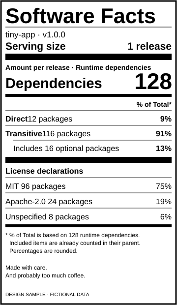

# Nibmark

**Give your project a nutrition label.**

Nibmark is a project in design that will turn a small text definition into a familiar, black-and-white **Software Facts** label for your README.

**Status: design stage.** The label below is a static design sample. The parser, renderer, and live editor have not been implemented. There is no published package or hosted editor yet.

[Design specification](design/software-facts-v0.1.md) · [Example syntax](#example-syntax) · [Roadmap](#roadmap)

## A familiar label for your project's ingredients

Dependencies become the headline number. Direct and transitive dependencies become the main ingredients. Included items sit beneath their parents, and license declarations appear below a thick divider.

The aim is simple: make something fun that developers want to put in their README.



## Example syntax

This is the proposed v1 syntax for the design sample above. All values are fictional and entered by the author.

```nibmark
nutrition v1
project "tiny-app" version "1.0.0"
serving "1 release"
scope "Runtime dependencies"
dependencies 128

group "Dependency composition" of dependencies
  item "Direct" 12
  item "Transitive" 116
    includes "Optional" 16

group "License declarations" of dependencies
  item "MIT" 96
  item "Apache-2.0" 24
  item "Unspecified" 8

note "Made with care. And probably too much coffee."
```

The code block identifier is `nibmark`. Inside it, `nutrition` selects the label type and `v1` selects the syntax version. The project version is a separate value.

Nibmark will calculate each percentage from the total dependency count. An `includes` item is already part of its parent; it is not added to the total again. `% of Total` describes composition, not a recommended dependency allowance.

## Planned first version

- A browser editor with text on one side and a live label preview on the other.
- A fixed nutrition-label layout with bold typography, clear hierarchy, and black rules.
- SVG and PNG downloads, plus a Markdown image snippet for your README.
- Save and reopen the text definition.
- English and Korean interface and label support.
- Local browser processing for label content.
- The same syntax for projects written in any language or framework.

The first version will render the information you enter. Automatic repository analysis, SBOM imports, and vulnerability lookups are future work.

## Planned workflow

1. Open the editor with a ready-made example.
2. Change the project name, counts, and ingredient labels.
3. Preview the result and download an image.
4. Commit the image to your repository and insert it into your README.

Once an image is saved at `docs/software-facts.svg`, a README can embed it with:

```markdown

```

GitHub does not currently provide native Nibmark rendering. A `nibmark` code block will display as source text unless the host has a Nibmark integration. The first version's README output will be an ordinary SVG or PNG image.

## Design principles

- Keep the recognizable nutrition-label silhouette and visual hierarchy.
- Describe content and relationships in text; let the renderer handle layout.
- Keep the core renderer independent of the editor framework and the project being described.
- Make definitions readable in version control.
- Show errors at the relevant line and preserve the last valid preview.

The design translates the information hierarchy of the updated US nutrition label into software terms: a clear serving basis, a prominent headline amount, nested ingredients, quantities alongside percentages, and a short explanation of the denominator.

## Roadmap

| Stage | Scope | Status |
| --- | --- | --- |
| Design | Name, purpose, proposed syntax, static label, acceptance criteria | Prepared for review |
| Renderer | Parser, validation, label model, typography and SVG rendering | Planned |
| Editor | Live preview, examples, English/Korean support, exports | Planned |
| First release | Visual checks, export compatibility, usage documentation | Planned |
| Later | SBOM import, project analysis, CLI and Markdown integrations | Outside the first version |

## Contributing

At this stage, useful feedback concerns the syntax, visual resemblance to a nutrition label, and how easily someone can make their first label. See the [design specification](design/software-facts-v0.1.md).

Development setup and contribution instructions will be added after the toolchain is implemented and verified. Installation commands and package badges will appear when there is a working release.

## Inspiration

- [Mermaid](https://github.com/mermaid-js/mermaid) — text definitions, rendered examples, and an approachable live-editor workflow.
- [FDA nutrition-label changes](https://www.fda.gov/food/nutrition-food-labeling-and-critical-foods/changes-nutrition-facts-label) — visual hierarchy and presentation of quantities and included ingredients.

Nibmark is an independent project. Its text and label design are being developed specifically for this use case.

## License

[MIT](LICENSE) © 2026 jhbrunokim.
