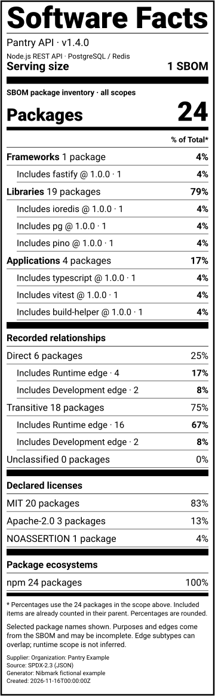
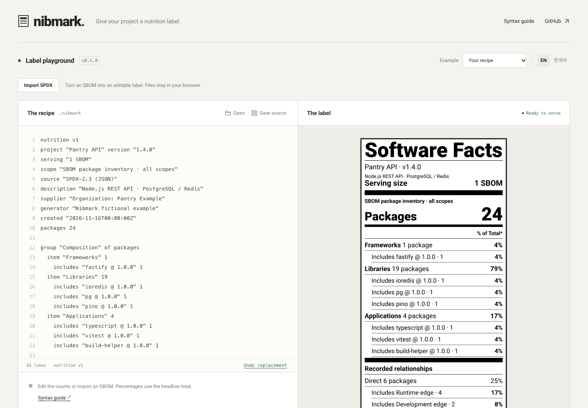

# Nibmark

**Give your project a nutrition label.**

Nibmark turns a small text definition into a familiar, black-and-white **Software Facts** label for your README. Import an existing SBOM or describe the ingredients; Nibmark handles the typography, layout, and percentages.

[Open the playground](https://jhbrunokim.github.io/nibmark/) · [Get started](#get-started) · [Syntax guide](docs/syntax.md) · [SPDX import](docs/spdx-import.md) · [Contributing](CONTRIBUTING.md)

**v0.5.0** — Try the [browser playground](https://jhbrunokim.github.io/nibmark/), or run it locally. There is no published npm package yet.



Generated from the [fictional Pantry API SPDX file](public/examples/pantry-api.spdx.json).
[View the matching Nibmark recipe](docs/examples/pantry-api.nibmark).

## Get started

Use Node.js 24.16+ and npm:

```sh
git clone https://github.com/jhbrunokim/nibmark.git
cd nibmark
npm ci
npm run dev
```

Open the Local URL printed by Vite. You will see an editable example and its rendered label.

1. Change the project name and ingredient counts.
2. Download SVG or PNG.
3. Add the image to your repository.
4. Copy the Markdown snippet into your README.

The project being described can use any language or framework. Only people developing or self-hosting Nibmark need Node.js; users of a hosted editor will only need a browser.

## Example

<details>
<summary>Pantry API — the recipe behind the label</summary>

```nibmark
nutrition v1
project "Pantry API" version "1.4.0"
serving "1 SBOM"
scope "SBOM package inventory · all scopes"
source "SPDX-2.3 (JSON)"
description "Node.js REST API · PostgreSQL / Redis"
supplier "Organization: Pantry Example"
generator "Nibmark fictional example"
created "2026-11-16T00:00:00Z"
packages 24

group "Composition" of packages
  item "Frameworks" 1
    includes "fastify @ 1.0.0" 1
  item "Libraries" 19
    includes "ioredis @ 1.0.0" 1
    includes "pg @ 1.0.0" 1
    includes "pino @ 1.0.0" 1
  item "Applications" 4
    includes "typescript @ 1.0.0" 1
    includes "vitest @ 1.0.0" 1
    includes "build-helper @ 1.0.0" 1

group "Recorded relationships" of packages
  item "Direct" 6
    includes "Runtime edge" 4
    includes "Development edge" 2
  item "Transitive" 18
    includes "Runtime edge" 16
    includes "Development edge" 2
  item "Unclassified" 0

group "Declared licenses" of packages
  item "MIT" 20
  item "Apache-2.0" 3
  item "NOASSERTION" 1

group "Package ecosystems" of packages
  item "npm" 24

note "Purposes follow SBOM records. Selected names only. Edges may be incomplete or overlap; runtime scope is not inferred."
```

</details>

The block name is `nibmark`. `nutrition` selects the label type and `v1` the syntax version.
Counts can be entered manually or imported from an SBOM. Each group must add up to the headline total.
An `includes` item is already counted in its parent. `% of Total` describes composition,
not a recommended dependency allowance.

## The playground



- Import SPDX 2.2/2.3 JSON or Tag/Value with a review of project root and counts.
- Live text editing with line numbers and precise syntax errors.
- A fixed nutrition-label layout: bold headline, thick rules, nested ingredients.
- English and Korean interface and label wording.
- SVG and 2× PNG downloads, plus a Markdown image snippet.
- Save/open `.nibmark` definitions and undo an example/file replacement.
- Copy an edit link that restores the recipe and English/Korean display language.
- Processing in browser memory; label contents are not sent to a server.
- Outlined SVG text preserves the appearance without installed fonts.

The examples are fictional. Nibmark is a presentation layer for existing SBOMs; it does not scan repositories or generate SBOMs.

## Put it in your README

After adding the downloaded image to your repository:

```markdown

```

GitHub does not render `nibmark` code blocks natively. Use the exported SVG or PNG.
If you put the image in another directory, update the Markdown path.

## Start from an SBOM

Choose **Import SPDX**, open an SPDX 2.2/2.3 JSON or Tag/Value file, review the project
root and counts, and select **Create label**. Package totals, recorded relationships,
declared licenses, ecosystems and provenance become editable text. No file is uploaded.
See the [generator compatibility and counting rules](docs/spdx-import.md) and the
[pinned upstream regression corpus](tests/fixtures/spdx/upstream/README.md).

## Share an editable label

Choose **Copy edit link** to share the current recipe and display language. The recipient
can edit their own copy; later edits do not change an earlier link. This is a link to the
editor, not a hosted image URL for Markdown.

The recipe is encoded in the URL fragment (after `#`). It is not sent to the hosting
server by the browser, and Nibmark does not upload it. Anyone holding the full link can
read its contents. Links are limited to 12,000 characters; use **Save source** for larger
recipes or if a messaging service truncates a link. Invalid links show a recovery message.
Opening another edit link in the same tab allows **Undo replacement**.

## Architecture

```text
Text → parser → label model → validation → layout → SVG
                                                    └→ PNG
```

- `src/core/`: framework-independent parser, model and count validation.
- `src/renderer/`: font measurement, nutrition layout and self-contained SVG.
- `src/editor/`: React playground, file operations and browser image exports.
- `src/importers/`: SPDX inventory normalization and conversion to editable Nibmark.
- `tests/`: parser, rendering, export and end-to-end tests.

One renderer serves both preview and download. The web editor is React + Vite;
the core has no React dependency.

## Development and checks

```sh
npm run build
npm test
npx playwright install chromium firefox webkit
npm run test:e2e
```

On a machine with Chrome installed, use `PLAYWRIGHT_CHANNEL=chrome npm run test:e2e`.
Browser tests cover editing, error recovery, exports, clipboard, source round trips,
Korean, mobile overflow and visual snapshots. See [Contributing](CONTRIBUTING.md).

`npm run preview` serves the production build locally. GitHub Actions tests and deploys `main` to GitHub Pages. The deployment build uses `--base=/nibmark/`; local builds keep relative paths. npm publishing remains a separate step.

## Current limits

- One label type: `nutrition v1`; all composition groups use the selected dependencies or packages count as their denominator.
- English, Korean and supported Latin characters/symbols. Unsupported characters, including most emoji, are reported as errors.
- 50 KB input, 200 characters per quoted string, 100 ingredient rows.
- Very tall labels can use SVG; PNG is capped at 16,000 pixels high and 16 megapixels.
- Display language is an editor setting. Source is kept in memory until you explicitly save it.
- Automated browser coverage uses Chromium, Firefox and WebKit. Real Safari/iOS devices still need manual verification.

## Read the ingredients

SPDX imports show package purposes as parent rows and representative package
names beneath them, like a nutrition label's nested ingredients. Project
descriptions appear below the heading; explicit dependency subtypes, licenses
and ecosystems add context. Missing purpose information stays unspecified. When no package has a recorded purpose,
PURL ecosystems provide a clearly identified fallback composition if available.

Try **Import SPDX → Download Pantry API example SPDX** in the playground, then
import that fictional example. See the [field mapping and selection rules](docs/spdx-import.md#hierarchical-ingredients-040).

## Roadmap

Completed foundations: label/browser work (0.2.0), SPDX 2.x import (0.3.0),
and hierarchical ingredients (0.4.0).

Required rounds, one at a time:

1. Real SBOM compatibility and missing-data presentation — completed in 0.5.0.
2. Select and pin representative ingredients and choose displayed sections.
3. Compact and detailed compositions within the same nutrition-label design.

Optional backlog (not scheduled as required rounds):

- SPDX 3.x JSON-LD and CycloneDX adapters.
- CLI conversion, GitHub Actions automation and Markdown renderer integrations.

Product direction: make existing generators' results easy to read and share.
Building another SBOM generator or repository analyzer is outside the roadmap.

See [versioning](VERSIONING.md) and [changes](CHANGELOG.md) for release tracking.

The [original design](design/software-facts-v0.1.md) records the product decisions;
the [syntax guide](docs/syntax.md) describes the implemented behavior.

## Inspiration

- [Mermaid](https://github.com/mermaid-js/mermaid): text definitions and an approachable live-editor workflow.
- [FDA nutrition-label changes](https://www.fda.gov/food/nutrition-food-labeling-and-critical-foods/changes-nutrition-facts-label): visual hierarchy, quantities and included ingredients.

Nibmark is an independent project and does not use Mermaid as a runtime dependency.

## License

[MIT](LICENSE) © 2026 jhbrunokim. Fonts retain their SIL Open Font License;
see [third-party notices](THIRD_PARTY_NOTICES.md).
